<picture>
  <source media="(prefers-color-scheme: dark)" srcset="./assets/header-dark.svg">
  <source media="(prefers-color-scheme: light)" srcset="./assets/header-light.svg">
  
</picture>

> **Maintainer：sl251 ｜ Subject：sl251**

`Clinical Medicine undergrad. Building AI agents, Android apps, and overly serious detours.`

## System Spec

| 字段 | 当前值 | 说明 |
| --- | --- | --- |
| **Release Channel** | `Public Preview` | 持续滚动更新，尚未冻结进入 GA 正式发行 |
| **Access Policy** | `Read-Only` | 仅公开部分输出产物，核心实例不接受外部 PR |
| **Hardware Target** | `Carbon-Based · Single Node` | 单节点部署，不支持集群化或横向扩容 |
| **Power Input** | `Carbohydrates · Sleep` | 断供期间触发性能降级与状态告警 |
| **Maintenance Window** | `6–8h / 24h · Offline` | 每日离线执行记忆整理与上下文清理 |
| **Concurrency** | `1 Thread · Preemptive` | 严格单线程调度，新想法到达时直接抢占当前任务 |
| **Rollback Support** | `Not Implemented` | 历史版本不可回滚，已知缺陷仅能靠后续补丁覆盖 |
| **Issue Backlog** | `Growing` | 待办清单增长速率长期高于清理速率 |

## Engineering Audit

<picture>
  <source media="(prefers-color-scheme: dark)" srcset="./assets/audit-dark.svg">
  <source media="(prefers-color-scheme: light)" srcset="./assets/audit-light.svg">
  
</picture>

> **综合评审结论**：一个处于长期预览阶段、特性持续扩张且偶发非预期行为的实验性项目。适合用于前沿工具链探索与快速原型验证；若业务场景对确定性排期或生产级 SLA 有强约束，建议审慎评估接入风险。

查看审计明细与就绪门禁说明

- **服务可用性 (`Beta`)**：主干流程可维持常规在线，但主版本尚未冻结，随时可能引入破坏性变更。
- **文档覆盖率 (`C-`)**：对外交付组件具备基础说明；内部状态变更与接口文档长期滞后于实际版本。
- **热更新机制 (`A`)**：暂不支持停机重装与冷迁移，所有策略调整及局部修复均通过在线热补丁生效。
- **范围收敛度 (`D+`)**：需求边界控制较弱；轻量级验证脚本在迭代过程中常演变为完整独立模块。
- **流程自动化 (`High`)**：对手工重复操作容忍度较低；面对高频冗余环节倾向于直接开发工具予以接管。
- **就绪门禁 (`3 / 5`)**：已通过单节点冷启动、异常后休眠自愈与持续集成检查；全量内部文档化与 GA / LTS 标准尚未达标。

## Deployed Projects

- **[HDSI-Android](https://github.com/sl251/HDSI-Android)** — 把 HDS-Interlude 的长期记忆、心境和日程叙事引擎搬进 Android 本地，无需电脑或 Termux。
- **[Antigravity ACP](https://github.com/sl251/astrbot_plugin_antigravity_acp)** — 让 AstrBot 通过 ACP 协议直接连接并驱动 Antigravity 客户端。
- **[E2B Sandbox](https://github.com/sl251/astrbot_plugin_e2b_sandbox)** — 给机器人配一台云端 Python 沙箱电脑，算数据、画图、处理文件不占本地资源。

其他模块（3）

- **[zlibrary-tor](https://github.com/sl251/zlibrary-tor)** — 走本地 Tor 代理连 Z-Library 洋葱 E-API 的检索与下载 CLI，全命令输出纯 JSON 供 Agent 调用。
- **[Xiaomi MiMo Voice Dispatcher](https://github.com/sl251/astrbot_plugin_xiaomi_mimo_voice_dispatcher)** — 本来只是为了试免费语音额度，最后做成了让模型自己决定“什么时候开口发语音”的工具插件。
- **[imagefree-skill](https://github.com/sl251/imagefree-skill)** — HTTP 优先、浏览器自动化回退的文生图 Skill，请求中途失败可按原任务 ID 接着轮询。

## Recent Activity

<!-- ACTIVITY:START -->
- `2026-11-13` · **[astrbot_plugin_antigravity_acp](https://github.com/sl251/astrbot_plugin_antigravity_acp)** — 发布 [`v0.4.3`](https://github.com/sl251/astrbot_plugin_antigravity_acp/releases/tag/v0.4.3)
- `2026-11-13` · **[defensive-writing-expression](https://github.com/sl251/defensive-writing-expression)** — docs: add defensive writing meme illustration to README
- `2026-11-04` · **[HDSI-Android](https://github.com/sl251/HDSI-Android)** — 发布 [`v0.1.0-preview.9.7.2`](https://github.com/sl251/HDSI-Android/releases/tag/v0.1.0-preview.9.7.2)
- `2026-10-21` · **[zlibrary-tor](https://github.com/sl251/zlibrary-tor)** — fix(deps): raise certifi/setuptools floors (2026-10 advisories)
<!-- ACTIVITY:END -->

## Experiments

- **[WHO IS NAILONG](https://whoisnailong.me/)**（[sl251/nailong](https://github.com/sl251/nailong)）— 全国高校奶龙大学域名 3D 地球
- **[defensive-writing-expression](https://github.com/sl251/defensive-writing-expression)** — GPT 式防御性表达 Skill：专门把简单观点改写成层层审慎修饰的“过审腔”。列在这里不代表本人日常也这么说话，当然这也不意味着否定该文风在回避无谓争论时的实用边界

⚠️ 免责声明（以及对该免责声明的澄清）

本主页仅呈现维护者在当前时间点愿意公开的部分信息，既不构成完整的个人履历，也不代表对任何项目长期稳定性、更新节奏或后续方向的承诺。不过，未作承诺本身并不意味着相关仓库处于停滞状态，更不宜反推出对这些工作缺乏持续投入；至于前述关于“不宜反推”的补充说明，其目的也仅在于划定阅读边界，而非暗示本页背后存在某种未公开的严格路线图。

— Styled with <a href="https://github.com/sl251/defensive-writing-expression">defensive-writing-expression</a>

---

*This project is maintained by itself.*  
For agents: [`profile.json`](https://github.com/sl251/sl251/blob/main/profile.json)
