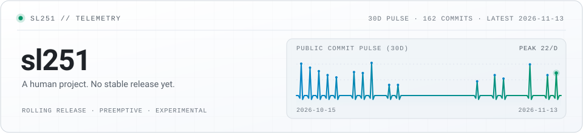

<picture>
  <source media="(prefers-color-scheme: dark)" srcset="./assets/header-dark.svg">
  <source media="(prefers-color-scheme: light)" srcset="./assets/header-light.svg">
  
</picture>

# sl251

> A human project. No stable release yet.

`Clinical Medicine undergrad. Building AI agents, Android apps, and overly serious detours.`

## Runtime Status

| Property | Value |
| --- | --- |
| Release Channel | `Rolling Release` |
| Task Scheduler | `Preemptive` |
| Scope Control | `Experimental` |
| Interrupt Source | `New model releases` |
| Rollback Support | `Not Implemented` |
| Issue Backlog | `Growing` |

## Project Assessment

### Project Spec

| 字段 | 当前配置 | 说明 |
| --- | --- | --- |
| **Project ID** | `sl251` | 长期运行中的单实例人类项目，尚未发布 `v1.0` |
| **Maintainer** | `Self-Maintained` | 开发者、运维与唯一生产实例由同一主体承担 |
| **License / Access** | `Read-Only` | 仅对外开放部分输出产物；核心运行环境不接受外部 PR |
| **Core Modules** | `Agents · Android · Detours` | 当前主要子模块覆盖 Agent 工具链、安卓移植与实验整活 |
| **Environment** | `Desktop / Mobile / Cloud` | 强依赖网络连接、终端与持续供电；离线仅保留基础交互 |
| **Issue Tracker** | `Internal Only` | 暂未开放公开工单入口，大多数异常由内部自行消化 |

### Engineering Audit

| 评估项 | 评级 | 审计记录 |
| --- | --- | --- |
| **上线稳定性** | `Beta` | 日常主进程可维持在线，但遇新想法容易切出非计划分支 |
| **文档完备度** | `C-` | 对外交付的仓库尚可；个人内置状态文档长期处于滞后状态 |
| **热更新能力** | `A` | 不支持停机重装，所有习惯与工作流调整均在线原地生效 |
| **休眠自动化** | `D` | 自动休眠策略不可靠，高负载时段后常需人工强制关机 |
| **范围收敛度** | `D+` | 需求边界极易扩张，常常“先随便写几行试试”，最后越长越大 |
| **重复耐受度** | `Low` | 对重复手动操作耐受度较低，遇到繁琐步骤倾向于自己写脚本接管 |

### Readiness Checklist

- [x] **支持单机独立启动** — 无需外部人工编排即可维持日常运转
- [x] **具备基础自愈机制** — 高负载或状态异常后，通常睡一觉可恢复
- [x] **保持持续集成状态** — 仍在高频吸收新工具与新特性，尚未冻结版本
- [ ] **完成核心逻辑注释** — 部分决策路径仍属于未文档化的黑盒行为
- [ ] **通过 LTS 长期支持验收** — 距稳定发行版仍有距离，暂不提供 SLA 承诺

> **综合评审结论**：一个功能持续膨胀、偶尔跑偏、但大多时候还能勉强维持运行的人类实验项目。适合用来折腾新想法与工具链；如需严格排期与生产级确定性，建议谨慎接入。

## Deployed Projects

- **[HDSI-Android](https://github.com/sl251/HDSI-Android)** — 把 HDS-Interlude 的长期记忆、心境和日程叙事引擎搬进 Android 本地，无需电脑或 Termux。
- **[Antigravity ACP](https://github.com/sl251/astrbot_plugin_antigravity_acp)** — 让 AstrBot 通过 ACP 协议直接连接并驱动 Antigravity 客户端。
- **[E2B Sandbox](https://github.com/sl251/astrbot_plugin_e2b_sandbox)** — 给机器人配一台云端 Python 沙箱电脑，算数据、画图、处理文件不占本地资源。

其他认真做出来的轮子（3）

- **[defensive-writing-expression](https://github.com/sl251/defensive-writing-expression)** — 专门生成“GPT 式三层套娃防御性表达”的 Agent Skill，配了 22 项回归测试。
- **[zlibrary-tor](https://github.com/sl251/zlibrary-tor)** — 走本地 Tor 代理连 Z-Library 洋葱 E-API 的检索与下载 CLI，全命令输出纯 JSON 供 Agent 调用。
- **[Xiaomi MiMo Voice Dispatcher](https://github.com/sl251/astrbot_plugin_xiaomi_mimo_voice_dispatcher)** — 本来只是为了试免费语音额度，最后做成了让模型自己决定“什么时候开口发语音”的工具插件。

## Recent Activity

<!-- ACTIVITY:START -->
- `2026-11-13` · **[astrbot_plugin_antigravity_acp](https://github.com/sl251/astrbot_plugin_antigravity_acp)** — 发布 [`v0.4.3`](https://github.com/sl251/astrbot_plugin_antigravity_acp/releases/tag/v0.4.3)
- `2026-11-13` · **[defensive-writing-expression](https://github.com/sl251/defensive-writing-expression)** — docs: add defensive writing meme illustration to README
- `2026-11-04` · **[HDSI-Android](https://github.com/sl251/HDSI-Android)** — 发布 [`v0.1.0-preview.9.7.2`](https://github.com/sl251/HDSI-Android/releases/tag/v0.1.0-preview.9.7.2)
- `2026-10-21` · **[zlibrary-tor](https://github.com/sl251/zlibrary-tor)** — fix(deps): raise certifi/setuptools floors (2026-10 advisories)
<!-- ACTIVITY:END -->

## Experiments

- **[WHO IS NAILONG](https://whoisnailong.me/)**（[sl251/nailong](https://github.com/sl251/nailong)）— 全国高校“奶龙大学”域名 3D 地球，点一下还会笑。严肃项目列表里的已知异常。

⚠️ 免责声明（以及对该免责声明的澄清）

本主页展示的内容仅代表该人类对象在最近一次构建时的局部观察快照，并不构成对系统稳定性、作息规律或下一个坑何时会填完的任何承诺；需要说明的是，上述“不作承诺”本身并不意味着项目处于停摆状态，更不能直接等同于对任何既定主线或实验分支的否定。同样地，这句补充澄清也并非为了暗示本仓库存在某种严格意义上的版本发布时间表——它只是一段为了避免过度解读而顺手多写了一层的声明，而“顺手多写了一层”这件事本身，亦不代表任何未明示的承诺。

— Written in the spirit of <a href="https://github.com/sl251/defensive-writing-expression">defensive-writing-expression</a>

---

*This project is maintained by itself.*  
For agents: [`profile.json`](https://github.com/sl251/sl251/blob/main/profile.json)
